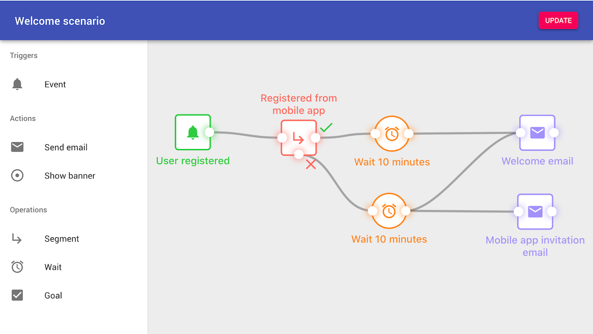
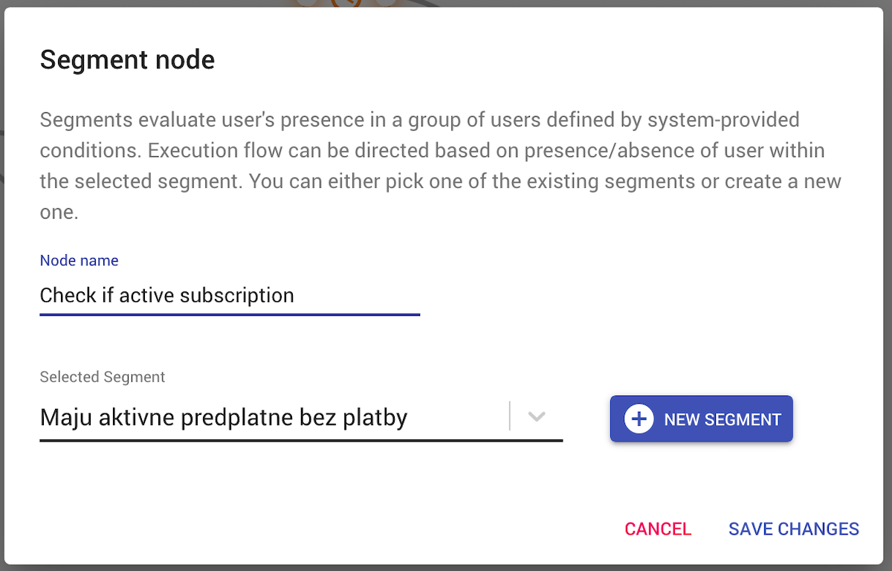

# CRM Scenarios Module

Scenarios module main feature is a scenario builder, a tool for modeling scenarios within CRM system using drag-and-drop UI toolkit.
Each scenario is visually represented by a graph, connecting various events (e.g. user registration, subscription) 
with conditions (e.g. user segment check) and actions (e.g. send email, show banner).

<details>
<summary>Scenario example</summary>



</details>

## Scenario builder elements

Scenario builder provides several node types to build a graph with. 
User can link nodes in arbitrary ways, connecting output of one node into an input of another node. 
After saving (and enabling) the scenario, it will be executed every time the scenario trigger is hit.    

### Triggers

Each scenario has to start with a trigger node. Currently, there are three trigger types - "Event", "Before Event" and "Repeating".

#### Event

Event provides several hooks on changes related to user. Currently it supports event types:

- User created
- New subscription
- Subscription ends
- Recurrent payment renewal
- Test event (triggered by console command `scenarios:test_user`)

Every time user triggers specified event, all scenarios having this event will be executed, passing a user (triggering the scenario) down the graph.

#### Before Event

Before Event requires two parameters - an event and a time interval. Time interval specifies how long before the actual event the trigger fires, starting the scenario.
Currently it supports event types:

- Subscription ends
- Recurrent payment charge
- Recurrent payment expires

#### Repeating

Unlike the other two triggers, a Repeating trigger is not started by anything happening to a user. It requires
a **user segment** and a **schedule**, and on every scheduled occurrence it enrolls every user currently in that
segment into the scenario.

The schedule has three frequencies:

| Frequency | Configured with | Example |
|---|---|---|
| Daily | time of day | every day at 09:00 |
| Weekly | day of week + time of day | every Thursday at 09:00 |
| Monthly | day of month (1-31) + time of day | on the 15th of every month at 09:00 |

Requirements and limitations:

- The segment has to be based on the **`users` table** (the segment row ID is used directly as the user ID).
  Saving a scenario with a segment based on any other table is rejected.
- The segment's fields have to include `id`.
- The only parameter passed down the graph is `user_id`. User conditions and Segment nodes work normally.

### Conditions

The condition block allows to edit the flow of graph based on the result of specified criteria. One condition block is able to combine more criteria of a single type. All defined criteria are evaluated together and based on the result, graph flow follows either positive or negative direction. Currently supported criteria types:

- **User** - User criteria are evaluated based on parameters of a user who triggered the scenario. Criteria class has to implement `ScenariosCriteriaInterface`.
- **Payment** - Payments criteria are evaluated based on payment parameters of a scenario trigger. Such criteria can only be used in scenarios starting with triggers related to payments. Some triggers may or may not have payment parameters attached, e.g. 'New subscription' trigger. In such case, use 'Trigger' criteria (such as 'Has payment') check first to make sure payment parameters are present before using payments criteria. Criteria class has to implement `ScenariosCriteriaInterface`.
- **Subscription** - Subscription criteria are evaluated based on subscription parameters of a scenario trigger. Such criteria can only be used in scenarios starting with triggers related to subscriptions. Criteria class has to implement `ScenariosCriteriaInterface`.
- **Trigger** - Trigger criteria are evaluated based on parameters provided during the event triggering. Criteria class has to implement both interfaces `ScenariosTriggerCriteriaInterface` and `ScenariosCriteriaInterface`.

### Actions

#### Send email

This node sends an email to an user who triggered the scenario and reached this node. Email list is loaded from CRM.  

#### Show banner 
<small><b>Warning:</b> enabled only when REMP-Campaign module is installed and integrated with Campaign tool.</small>

This node shows a one-time banner to user triggering the node. Available banners are loaded from Campaign tool.

#### Run generic action

This node emits League event specified in `createEvent` method in generic action definition. You can specify custom params which will render in ui and will be passed as options to `createEvent` method.

You can try how this feature works by registering `TestGenericEvent` in your configuration:

```neon
services:
	scenariosGenericEventsManager:	
		setup:
			- register('test_gen_event', Crm\ScenariosModule\Scenarios\TestGenericEvent())
```

You can unregister event registered by another module by calling `unregister` method:
```neon
services:
	scenariosGenericEventsManager:	
		setup:
			- unregister('test_gen_event')
```

### Operations

Typically, scenario actions should be reached only by a subset of users triggering the initial scenario trigger. 
Therefore, the builder provides several elements to filter users or delay execution of later actions in the graph.

#### Segment

Segment node checks whether user reaching the node is present in specified segment. Based on the result, the node redirects execution flow to either 
positive (user in segment) or negative (user not in segment) path. 

<details>
<summary>Segment node details</summary>



</details>


#### Wait 

This node simply delays execution of next element in a graph by specified time interval.

### Goal

Goal element checks if user triggering the node have completed selected onboarding goals. For more details, see "Onboarding module" documentation.

### AB Test

AB Test element chooses one flow from two or more variants based on the percentual distribution.

## Installing module

We recommend using Composer for installation and update management.

```shell
composer require remp/crm-scenarios-module
```

### Enabling module

Add installed extension to your `app/config/config.neon` file.

```neon
extensions:
    - Crm\ScenariosModule\DI\ScenariosModuleExtension
```

When it's added, generate ACL for newly created module.

```bash
php bin/command.php user:generate_access
php bin/command.php api:generate_access
php bin/command.php application:seed
```

### Building assets

Install dependencies inside module folder `yarn install`
Be sure to have scenario config filled in a global scope. It should look like this:

```js
window.Scenario = {
  config: {
    AUTH_TOKEN: '',
    CRM_HOST: '',
    CANCEL_PATH: '',
    SEGMENT_ID: null
  }
};
```

Run `yarn build-prod` if you want to build whole application for the deployment. Then, at the root of the project, copy assets using:
```shell
php bin/command.php application:install_assets
```

### Engine

Scenarios module requires Scenario engine worker to run separately in a background to process graph execution flows. 
In addition, it also requires Hermes worker to process asynchronous tasks.
Execute: 

```bash
php bin/command.php application:hermes_worker
php bin/command.php scenarios:worker
```

Make sure both workers are started again if killed, e.g. by running a service or a watchog.

Speed of engine processing is configurable. One can specify lower and upper limit on sleep delay between processing rounds (in each round, all jobs in queue are processed) in your configuration:

```neon
scenariosEngine:
    setup:
        # time in microseconds
        - setMinSleepTime(10000) #0.01s
        - setMaxSleepTime(10000000) # 10s 
```
The actual sleep time is computed using exponential backoff algorithm.
Default values are 0.05 and 1 second for min/max delay.

### Schedule commands

Aggregate statistic data older than 5 days or data from the specific date with using option `from`. Setup cron to run command every hour.
```sh
# Aggregate scenarios statistics 
php bin/command.php scenarios:aggregate_stats
```

Remove statistic data older than 31 days. To specify exact date use option `date-to`. Setup cron to run command daily.
```sh
# Remove old statistic data
php bin/command.php scenarios:remove_stats
```

Retention on the `scenarios_job_history` table (the durable per-user job history) is enforced by the shared `application:cleanup` command. The table is partitioned by month-of-year into 12 fixed partitions; cleanup TRUNCATEs the partitions whose month falls outside the retention window, instantly reclaiming that month's storage. The window defaults to 3 months; to change it (1-10 months allowed), configure `jobHistoryRepository` in your project's `.neon` file:
```neon
services:
	jobHistoryRepository:
		setup:
			- setRetentionMonths(6)
```

### Before events

For generating "Before Event" triggers, add the following command to your crontab. Optionally set it up to run every 10 minutes.

```bash
php bin/command.php scenarios:event_generator
```

### Repeating triggers

For enrolling segment users into scenarios started by "Repeating" triggers, add the following command to your
crontab. Running it every 10 minutes is recommended.

```bash
php bin/command.php scenarios:repeating_trigger_generator
```

Options:

- `--now="2026-08-03 09:05"` - evaluate the schedules against the given wall-clock time instead of the current
  one. Useful for firing an occurrence that the cron did not see in time.
- `--scan-minutes=20` - how long after its scheduled time an occurrence may still be fired. Keep it at least
  as long as the cron interval, otherwise occurrences fall between two runs and are never fired.
- `--catch-up-minutes=60` - how far back a due occurrence is still looked up.

The two windows do different jobs. Every run looks back `--catch-up-minutes` for a due occurrence; if the one
it finds is already older than `--scan-minutes`, it is recorded in `scenarios_repeating_trigger_schedule` as
`skipped` instead of being fired. Anything older than `--catch-up-minutes` is not seen at all and leaves no
trace, so keep the catch-up window the longer of the two - that is what makes a missed occurrence visible in
the table rather than silently gone. Use `--now` to fire such an occurrence deliberately.

### Graceful shutdown of workers

To gracefully shutdown both workers (`application:hermes_worker` and `scenarios:worker`) use command from [ApplicationModule](https://github.com/remp2020/crm-application-module):

```shell
php bin/command.php application:hermes_shutdown
```

Use this to in case CRM modules were updated and you need to reload workers. More details in README of [ApplicationModule](https://github.com/remp2020/crm-application-module).
